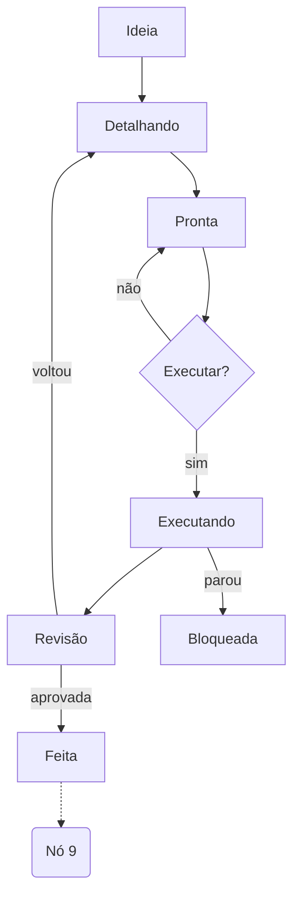
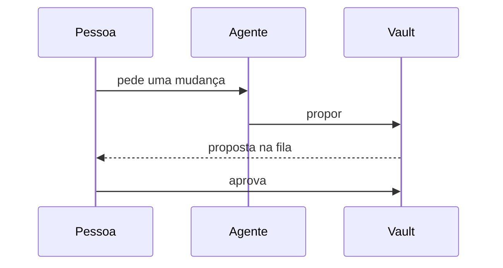

# Diagrama mermaid

Um bloco ````mermaid` vira desenho ao abrir a página. Clique no
diagrama para ver e editar o código; clique fora para ele redesenhar.

## Fluxo de uma tarefa



## Quem fala com quem

