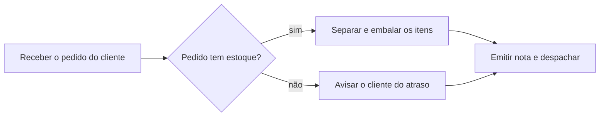
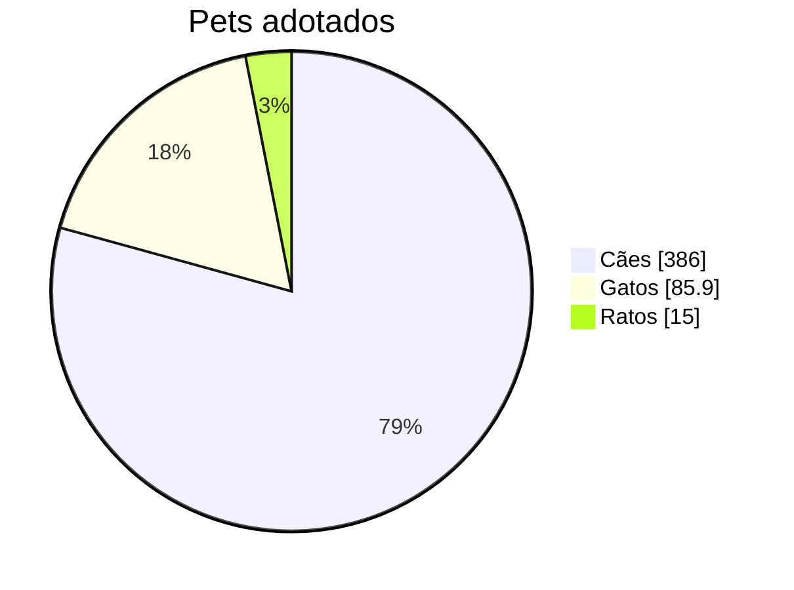
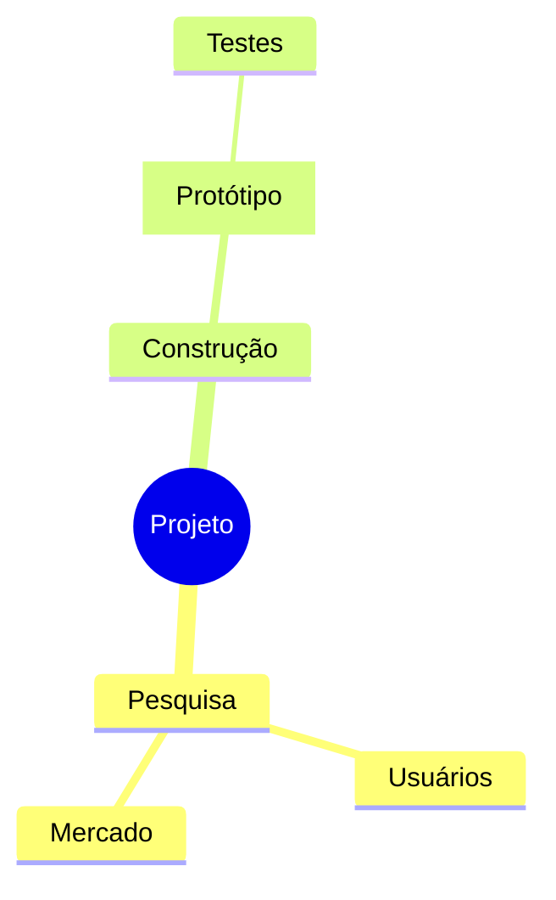
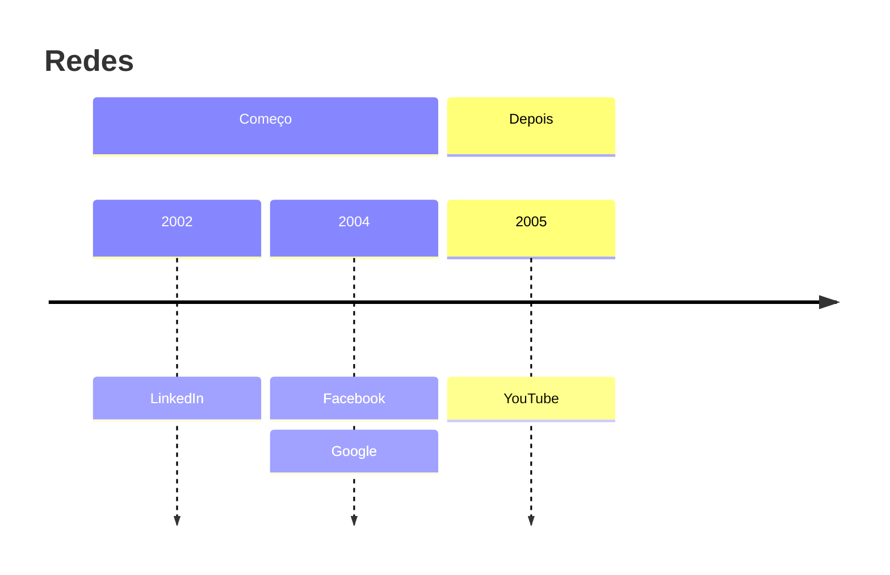
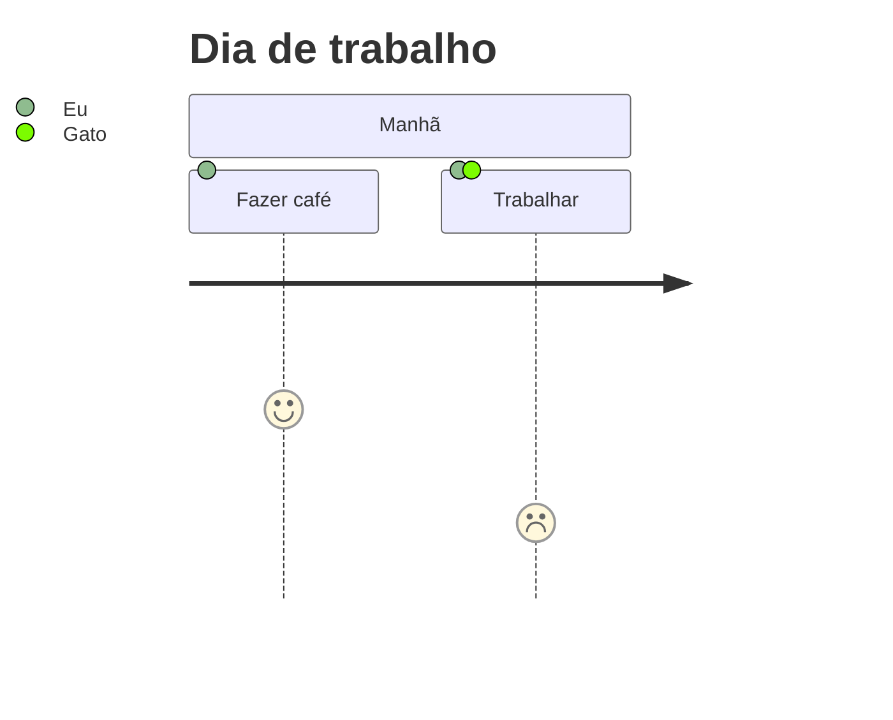
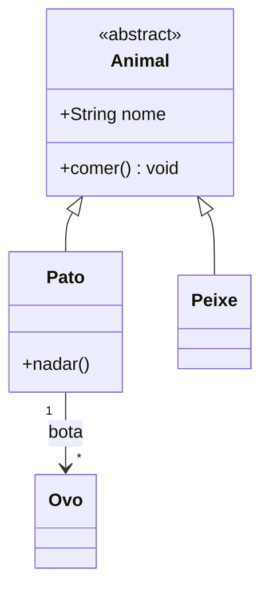
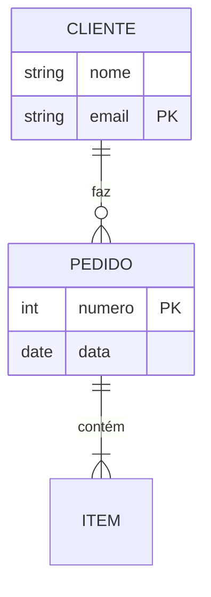

# Diagramas no terminal

Os tipos que a TUI desenha desde o ciclo 499, e um fluxograma largo pra entrar no bloco (Enter) e rolar de lado (ciclo 498).

## Fluxograma largo

## Pizza

## Mapa mental

## Linha do tempo

## Jornada

## Classes

## Entidade-relação

